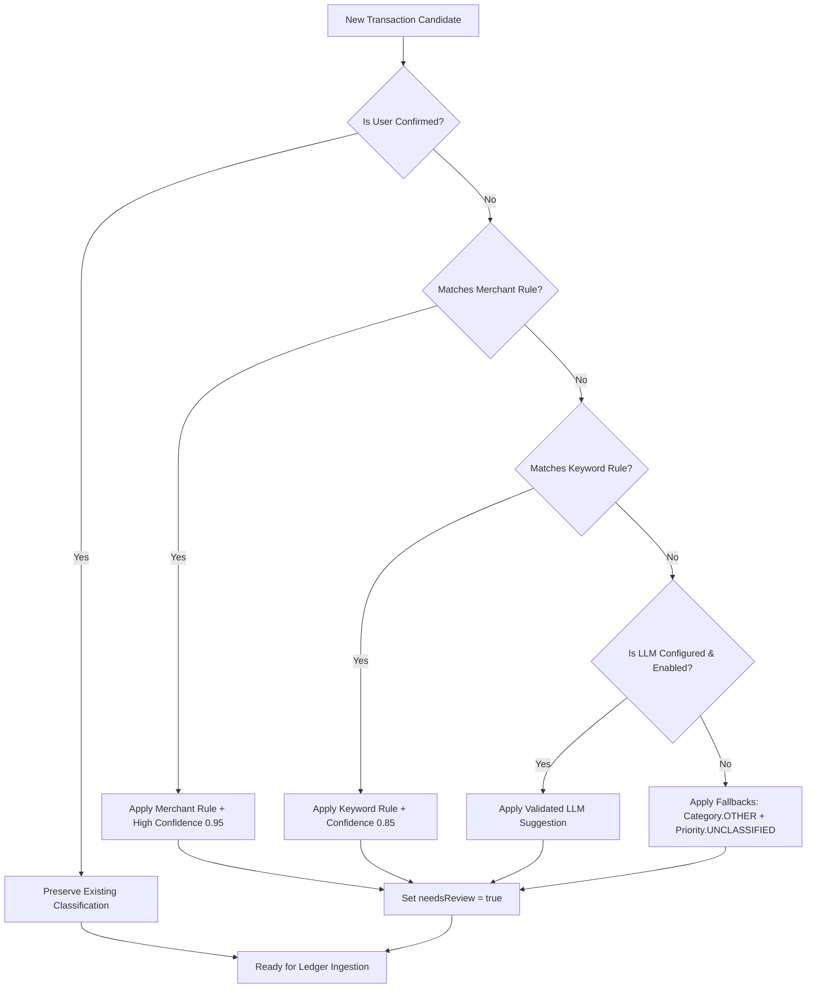

# Finance One — Transaction Classification Taxonomy & Provider Contract

**Document Status:** Formalized & Active  
**Scope:** Canonical Ingestion, Financial Semantics, Classification Taxonomy, Provider-Neutral Contract, and User Correction Preservation  
**Author:** Core Engineering & Architecture Team  

---

## 1. Executive Summary

Finance One enforces an immutable, normalized financial knowledge foundation. To support modular, provider-independent classification (deterministic rules, merchant lookups, local Ollama models, and third-party LLMs) without compromising financial calculation integrity, the classification system is formalized into four logically independent dimensions:

```text
┌─────────────────────────────────────────────────────────────────────────────────────────┐
│                                   INPUT ADAPTERS                                        │
│             Manual Form  ·  Quick Add  ·  CSV  ·  Excel (XLSX)  ·  PDF Statement        │
└────────────────────────────────────────────┬────────────────────────────────────────────┘
                                             │
                                             ▼
┌─────────────────────────────────────────────────────────────────────────────────────────┐
│                           DIMENSION 1: FINANCIAL ELIGIBILITY                            │
│    Is this row an Expense Debit?  (Credits, Transfers & Balances Excluded from Ledger)  │
└────────────────────────────────────────────┬────────────────────────────────────────────┘
                                             │
                                             ▼
┌─────────────────────────────────────────────────────────────────────────────────────────┐
│                             MODULAR CLASSIFICATION PIPELINE                             │
│   Precedence: User Confirmed  >  Merchant Map  >  Keyword Rules  >  LLM  >  Fallback    │
├─────────────────────────────────────────────────────────────────────────────────────────┤
│  DIMENSION 2: Category        │  DIMENSION 3: Spending Tier   │  DIMENSION 4: Tags      │
│  What money was spent on      │  Budgetary Necessity          │  Orthogonal Attributes  │
│  (11 Established Enums)       │  (4 Established Enums)        │  (Sanitized string[])   │
└────────────────────────────────────────────┬────────────────────────────────────────────┘
                                             │
                                             ▼
┌─────────────────────────────────────────────────────────────────────────────────────────┐
│                             CANONICAL TRANSACTION LEDGER                                │
│       PostgreSQL Canonical Truth  ·  Deterministic Sums  ·  User Data Scoped Isolation  │
└─────────────────────────────────────────────────────────────────────────────────────────┘
```

---

## 2. The Four Independent Dimensions

### Dimension A: Financial Meaning and Transaction Eligibility

Before any classification can occur, the financial meaning of the input row must be established:

| Record Type | Description | Ledger Action | Expense Total Impact |
| :--- | :--- | :--- | :--- |
| **`EXPENSE`** | Outgoing debit representing real economic expenditure. | Persisted to `Transaction` ledger. | **Included** in `totalSpent` & budgets. |
| **`INCOME` / `SALARY`** | Incoming credit deposit, payroll, refund, or interest. | Excluded from expense ledger (or tracked separately). | **Excluded** — zero inflation of expenses. |
| **`TRANSFER`** | Internal account rebalancing or wallet transfer. | Excluded from expense ledger. | **Excluded** — zero inflation of expenses. |
| **`BALANCE_SUMMARY`** | Opening balance, closing balance, or statement header/footer. | Filtered during parse/normalization. | **Excluded** — zero inflation of expenses. |
| **`INVALID`** | Malformed record missing amount, date, or description. | Flagged as `INVALID` in preview for user correction. | Rejected until corrected. |

> [!IMPORTANT]
> **Deterministic Eligibility Invariant**: Financial eligibility is strictly determined by statement direction (debit vs credit), running balance reconciliation, and explicit amount rules. **Financial eligibility must NEVER depend on an LLM or ML classifier.** A valid expense debit must never be discarded because its category or spending tier is unknown.

---

### Dimension B: Expense Category

Expense categories describe **what** money was spent on. Categories are completely independent of spending tiers, budget limits, or cashflow timing.

Finance One defines exactly **11 established category enum values** in `Category`:

| Enum Value | Label in UI | Icon | Canonical Domain Scope |
| :--- | :--- | :---: | :--- |
| **`FOOD`** | Food & Dining | 🍔 | Groceries, restaurants, cafes, snacks, food delivery (Swiggy, Zomato, Blinkit). |
| **`FUEL`** | Fuel & Transport | ⛽ | Petrol, diesel, CNG, fuel stations (Shell, HPCL, BPCL), local commute transit. |
| **`SHOPPING`** | Shopping | 🛍️ | Retail, clothing, personal goods, electronics, online marketplaces (Amazon, Flipkart). |
| **`BILLS`** | Bills & Utilities | 💡 | Electricity, water, rent, internet, mobile recharge, maintenance, utility bills. |
| **`ENTERTAINMENT`** | Entertainment | 🎬 | Movies, concerts, gaming, outings, streaming clubs, theatres (PVR, INOX). |
| **`HEALTH`** | Health & Care | 🩺 | Doctors, pharmacies, medicines, fitness, clinics, hospital expenses. |
| **`TRAVEL`** | Travel & Vacations | ✈️ | Long-distance travel, vacations, flights, hotels, holiday bookings. |
| **`EDUCATION`** | Education | 📚 | Courses, tuition fees, schooling, books, stationery, professional training. |
| **`SUBSCRIPTION`** | Subscriptions | 📱 | Digital recurring services: Netflix, Spotify, iCloud, ChatGPT, SaaS tools. |
| **`GIFT`** | Gifts & Donations | 🎁 | Celebrations, presents, charities, temple/church donations. |
| **`OTHER`** | Other / Misc | 📦 | General miscellaneous expenses; designated fallback when no specific category applies. |

---

### Dimension C: Spending Tier (Priority)

Spending tiers describe the **budgetary necessity and intent** of the expenditure.

Finance One defines exactly **4 established spending tier enum values** in `Priority`:

| Enum Value | Label in UI | Intent Badge | Semantic Meaning |
| :--- | :--- | :--- | :--- |
| **`ESSENTIAL`** | Essential | `Core Needs` | Non-negotiable survival needs: rent, utilities, basic groceries, essential medicines, work commute. |
| **`GOOD_TO_HAVE`** | Good to Have | `Comfort & Lifestyle` | Lifestyle enhancements and comforts: dining out, shopping, hobbies, cabs, subscriptions. |
| **`LUXURY`** | Luxury | `Discretionary` | Discretionary premium spending: fine dining, vacations, 5-star hotels, luxury retail. |
| **`UNCLASSIFIED`** | Unclassified | `Pending Review` | Legitimate baseline state for unclassified transactions or imported records awaiting review. |

> [!IMPORTANT]
> **Unclassified Spending Tier Invariant**:
> 1. `UNCLASSIFIED` is a legitimate, fully supported database enum value, NOT an error state or validation failure.
> 2. Missing spending tiers in statement imports or manual forms **NEVER silently default to `GOOD_TO_HAVE` or `ESSENTIAL`**.
> 3. Valid expenses with an `UNCLASSIFIED` tier are **fully persisted and count in `totalSpent` and dashboard aggregates**.

---

### Dimension D: Optional Tags

Tags represent **orthogonal attributes** that cut across categories and spending tiers.

- **Storage**: Persisted as a sanitized JSON array (`string[]`) within `sourceMetadata.tags`.
- **Validation**: Lowercase, alphanumeric plus underscores/hyphens (`[a-z0-9_-]`), 1 to 30 characters, maximum 10 tags per transaction.
- **Independence**: Tags must **not** duplicate Category or Spending Tier names (e.g. no redundant `food` or `essential` tags).

#### Canonical Tag Vocabulary
- `recurring` — Regular predictable bills or obligations.
- `subscription` — Active digital or SaaS recurring memberships.
- `work_expense` — Professional, office, or business expenses.
- `reimbursable` — Out-of-pocket expenses to be claimed from an employer or client.
- `tax_deductible` — Eligible for tax deduction or medical exemption.
- `travel_trip` — Expenses incurred during a specific trip or vacation.
- `emergency` — Unplanned critical spending.
- `shared_split` — Group expenses split with roommates or family.

---

## 3. Unknown and Ambiguous States

Finance One adheres to explicit, deterministic fallback behavior:



1. **Unknown Category**: Defaults to `Category.OTHER` with `needsReview = true`.
2. **Unknown Spending Tier**: Defaults to `Priority.UNCLASSIFIED` with `needsReview = true`.
3. **Missing Tags**: Normalized to empty array `[]` without error.
4. **Low Confidence Predictions**: Any suggestion with confidence `< 0.65` flags `needsReview = true`.
5. **No Rejected Expenses**: Ambiguity in classification **NEVER** invalidates an otherwise valid expense debit.

---

## 4. Provider-Independent Classifier Contract

To prevent vendor lock-in and enable hybrid classification (offline rules, local Ollama, cloud LLMs, user merchant maps), all classifiers implement the `TransactionClassificationProvider` interface:

```typescript
export interface TransactionClassificationProvider {
    readonly providerId: string;
    readonly providerType: "deterministic_rule" | "merchant_map" | "local_llm" | "cloud_llm";
    readonly priorityOrder: number; // Lower numbers execute earlier

    classify(candidate: ClassificationCandidate): Promise<ClassificationSuggestion | null>;
    classifyBatch?(candidates: ClassificationCandidate[]): Promise<(ClassificationSuggestion | null)[]>;
}
```

### Core Invariants of the Contract
1. **Read-Only Financial Values**: `amount`, `transactionDate`, `source`, and financial direction are read-only.
2. **Strict Output Validation**: Provider outputs are validated against `TAXONOMY_CATEGORIES` and `TAXONOMY_PRIORITIES`. Unrecognized values are stripped.
3. **Confidence Bounding**: All confidence outputs are clamped to `[0.0, 1.0]`.
4. **Rules-Only Operation**: In environments where no AI or LLM is configured, the system executes seamlessly using `MerchantRuleClassifier` and `RuleBasedClassifier` with zero network overhead.

---

## 5. Preservation of User Corrections

A critical requirement is that a user's explicit classification decisions must be preserved permanently:

1. **Transaction Edits**:
   When a user updates a transaction's category or spending tier via the UI or API (`updateTransaction`), `sourceMetadata` is stamped with:
   ```json
   {
     "userConfirmed": true,
     "classificationSource": "USER_EDIT",
     "classifiedAt": "2026-10-15T18:15:00.000Z"
   }
   ```
2. **Statement Reimports**:
   When a statement containing previously imported transactions is re-imported:
   - Deduplication matches the transaction via `externalId` or deterministic content fingerprint (`source:amount:date:title`).
   - The preview engine flags the row as `CONFIRMED_DUPLICATE` ("Already exists in your financial ledger").
   - The ingestion service returns the existing ledger record without overwriting it.
   - The user's confirmed category and spending tier are **100% preserved**.
3. **Transaction vs Merchant Scope**:
   Individual transaction edits apply strictly to the specific transaction ID. They do not silently alter global merchant rules unless the user explicitly saves a reusable rule.

---

## 6. Layer-by-Layer Alignment Summary

| Layer | Files | Taxonomy Alignment |
| :--- | :--- | :--- |
| **Prisma Schema** | `apps/server/prisma/schema.prisma` | `Category` (11 enums), `Priority` (4 enums including `UNCLASSIFIED`), `sourceMetadata Json?`. |
| **Ingestion Pipeline** | `apps/server/src/ingestion/` | Normalizers, validators, and contracts enforce `Category.OTHER` and `Priority.UNCLASSIFIED` defaults and sanitize `tags`. |
| **Classification Engine** | `apps/server/src/classification/` | Provider interface, rule-based classifier, merchant rule classifier, LLM interface, and orchestrator. |
| **Statement Import** | `apps/server/src/import/` | Row transformer excludes credits and balances, defaults missing tiers to `UNCLASSIFIED`, preserves user edits on reimport. |
| **Server Schemas & Repositories** | `apps/server/src/schemas/`, `apps/server/src/repositories/` | Zod validation and query schemas support `tags`, `UNCLASSIFIED`, and stamp user confirmation metadata. |
| **Frontend Types & Schemas** | `apps/web/src/types/`, `apps/web/src/utils/` | Zod schemas and TypeScript interfaces reflect all 11 categories, 4 spending tiers, and optional tags. |
| **UI Components** | `apps/web/src/components/` | PriorityBreakdown, PrioritySelector, CategorySelector, and forms render `UNCLASSIFIED` as "Unclassified / Pending Review". |
| **Analytics Engine** | `apps/server/src/services/dashboard.service.ts` | `aggregateTotalSpent` sums expense debits only; `groupPriorityTotals` aggregates all 4 tiers including `UNCLASSIFIED`. |
