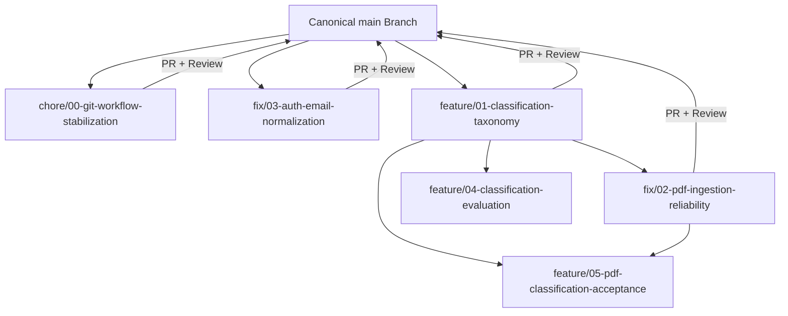

# Finance One — Git Workflow, Branching Strategy & Repository Baseline

**Document Status:** Approved Repository Standard  
**Effective Date:** 2026-10-15  
**Scope:** Multi-Agent Branching Convention, Dependency Tracking, PR Lifecycle, and Merge Policy  
**Author:** Core Architecture & Engineering Team  

---

## 1. Canonical Repository Baseline

Finance One uses a single canonical trunk (`main`) hosted on GitHub:

- **Canonical Remote URL:** `https://github.com/SumedhGaikwad03/Finance_one.git` (`origin`)
- **Default Production Branch:** `main`
- **Remote `origin/main` Commit:** `9675fa419bdca930d63425b60d252f9efd670bf2`
- **Local `main` Commit:** `9ca4096b562dd4632f43a6ba848b2f494b697680`
- **Sync Status:** Local `main` is strictly 6 commits ahead of `origin/main` (pure fast-forward descendant, 0 commits behind). All intermediate branches (`backup-before-pull`, `feature/ai-pipeline-stabilization`, `feature/phase-3-csv-xlsx-import`, `test/phase-3-import-verification`) have been merged into local `main`.

---

## 2. Numbered Branch Naming Convention

To support multiple autonomous agents and human engineers working in parallel without branch collision or merge ambiguity, all working branches must follow the standardized numbered naming format:

```text
<type>/<number>-<descriptive-name>
```

### Format Specification
- `<type>`: One of the conventional Git work types:
  - `feat` (or `feature`): New product capabilities or major feature modules.
  - `fix`: Bug fixes and defect repairs.
  - `chore`: Tooling, workflow, dependencies, refactoring, or infrastructure.
  - `test`: Test suites, fixtures, and regression coverage.
  - `docs`: Documentation, architecture blueprints, or guides.
- `<number>`: Two-digit zero-padded sequential identifier (`00`, `01`, `02`, ...). Each workstream has a globally unique number that is **never reused**.
- `<descriptive-name>`: Lowercase kebab-case summary of 2 to 5 words.

### Standardized Branch Register & Roadmap

| Number | Branch Name | Purpose | Base | Dependencies | Status |
| :---: | :--- | :--- | :--- | :--- | :--- |
| **00** | `chore/00-git-workflow-stabilization` | Repository audit, numbered branch rules, PR policy, and workstream recovery plan. | `main` | None | **Active** |
| **01** | `feature/01-classification-taxonomy` | Formal taxonomy enums (`Category`, `Priority`), tags dimension, provider contract, and tests. | `main` | `00` | **Implemented (Pending Commit)** |
| **02** | `fix/02-pdf-ingestion-reliability` | Multi-line header boundary detection, right-aligned amount mapping, reconciliation, and PDF tests. | `feature/phase-4-pdf-import` / `main` | `01` | **Implemented (Pending Commit)** |
| **03** | `fix/03-auth-email-normalization` | Lowercase email trimming in auth schemas and user repository to prevent login 401s. | `main` | None | **Implemented (Pending Commit)** |
| **04** | `feature/04-classification-evaluation` | Automated benchmark suite for deterministic vs LLM classification accuracy and latency. | `main` | `01` | **Planned** |
| **05** | `feature/05-pdf-classification-acceptance` | End-to-end acceptance testing for PDF bank statements with automated classification. | `main` | `01`, `02` | **Planned** |

---

## 3. Parallel Development & Multi-Agent Model



### Core Collaboration Principles
1. **Trunk-Based Clean Origin**: Every independent feature branch MUST originate from the latest verified `main` commit.
2. **Explicit Dependency Declaration**: If branch $B$ requires contracts or types from branch $A$, this dependency must be recorded in the Branch Register. Branch $B$ may either:
   - Wait until branch $A$ merges into `main` before starting (Preferred).
   - Base off branch $A$ explicitly, with a documented rebase/merge plan once $A$ lands on `main`.
3. **No Hidden Cross-Branch Merging**: Never merge one feature branch into another feature branch silently to fix build errors.
4. **Agent Scope Independence**: Multiple agents working simultaneously must operate on distinct files or decoupled modules (e.g. Ingestion vs Analytics vs Auth vs Classification).

---

## 4. Pull Request & Merge Policy

### Pre-PR Verification Checklist
Before opening a Pull Request, the author or agent must execute and verify:
- [ ] Working tree contains only the files intended for this specific workstream.
- [ ] No secrets, `.env` files, credentials, or personal financial statements are staged.
- [ ] Database migrations are backward-compatible, non-destructive, and tested via `npx prisma migrate status`.
- [ ] Server tests pass 100%: `pnpm --filter server test`.
- [ ] Server production build passes: `pnpm --filter server build`.
- [ ] Web production build passes: `pnpm --filter web build`.

### PR Content Requirements
Every PR must include:
1. **Summary of Changes**: Concise bullet points explaining the problem and solution.
2. **Impacted Modules**: List of backend, database, and frontend areas modified.
3. **Verification Evidence**: Actual terminal output showing test counts and build results.
4. **Migration Notes**: Schema changes and migration script names, if any.
5. **Rollback Plan**: Strategy to revert safely without data loss.

### Merge Invariants
1. **Squash and Merge or Rebase**: Linear commit history is preferred on `main`.
2. **Branch Protection**: Direct pushes to `main` should be restricted once CI workflows are configured.
3. **No Unmerged Branch Deletion**: Never delete a branch or discard commits until verified on `main`.
4. **Post-Merge Verification**: After merging into `main`, verify `git pull origin main` and confirm tests continue to pass.

---

## 5. Existing Working Tree Inventory & Recovery Plan

An audit of the current working tree on `feature/phase-4-pdf-import` identified **32 modified files and 6 untracked file groups**. All 178 tests pass and builds succeed. However, this tree contains three logically distinct workstreams that must be recovered and separated cleanly:

### Inventory by Workstream

#### Workstream A: Authentication Case Normalization (`fix/03-auth-email-normalization`)
- **Files**:
  - `apps/server/src/schemas/auth.schema.ts`
  - `apps/server/src/repositories/user.repository.ts`
  - `apps/web/src/utils/auth.schema.ts`
- **Scope**: Trims and lowercases user email during login and lookup. Safe to merge independently.

#### Workstream B: Phase 4 PDF Parser & Amount Extraction (`fix/02-pdf-ingestion-reliability`)
- **Files**:
  - `apps/server/src/import/parsers/pdf.parser.ts`
  - `apps/server/src/import/mapping/column-matcher.ts`
  - `apps/server/src/import/mapping/row-transformer.ts`
  - `apps/server/src/import/services/import.service.ts`
  - `apps/server/src/import/types/import.types.ts`
  - `apps/server/src/import/index.ts`
  - `apps/server/src/import/reconciliation/`
  - `apps/server/src/tests/pdf-import.test.ts`
  - `apps/server/src/tests/reconciliation-and-parsing.test.ts`
  - `apps/web/src/components/import/StatementImportModal.tsx`
  - `apps/web/src/services/import.service.ts`
- **Scope**: Multi-line header continuation, right-aligned amount mapping, reconciliation. Base: `feature/phase-4-pdf-import` (or `main` with `01` dependency).

#### Workstream C: Classification Taxonomy & Contract (`feature/01-classification-taxonomy`)
- **Files**:
  - `apps/server/prisma/schema.prisma`
  - `apps/server/prisma/migrations/20261015160000_add_unclassified_priority/`
  - `apps/server/src/classification/`
  - `apps/server/src/ingestion/`
  - `apps/server/src/schemas/transaction.schema.ts`
  - `apps/server/src/repositories/transaction.repository.ts`
  - `apps/server/src/tests/taxonomy-and-classification.test.ts`
  - `apps/web/src/components/query/PrioritySelector.tsx`
  - `apps/web/src/components/dashboard/PriorityBreakdown.tsx`
  - `apps/web/src/components/dashboard/PriorityChart.tsx`
  - `apps/web/src/types/dashboard.types.ts`
  - `docs/architecture/classification-taxonomy.md`
- **Scope**: `UNCLASSIFIED` priority enum migration, 11 categories, 4 tiers, tags dimension, provider contract.

### Step-by-Step Safe Recovery Plan
To avoid accidental data loss, the recommended non-destructive sequence is:
1. **Preserve Current State in a Safety Branch**:
   Create a safety commit on branch `feature/phase-4-pdf-import` containing all current work so zero progress can ever be lost.
2. **Branch Workstream C (`feature/01-classification-taxonomy`)**:
   Establish the clean taxonomy branch based on `main`.
3. **Push `main` to `origin/main`**:
   Synchronize the 6 commits currently ahead on local `main` with remote `origin/main`.
4. **Open Reviewable PRs**:
   Submit clean, focused PRs following the numbered branch convention.
